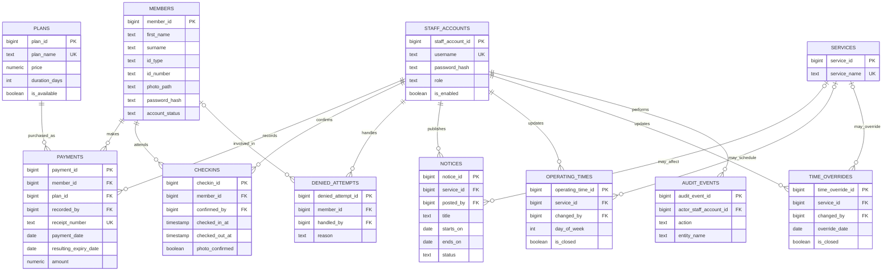

# Gym Management System — Database relationships

The relationships below reflect the *proposed PostgreSQL schema v1.0*. Optional `service_id` in notices/hours/overrides means the whole gym rather than an individual area. A current membership is **derived from payments**; there is no separate `membership` table duplicating plan/expiry state.

Additional foreign keys omitted from individual association lines for diagram readability: `CHECKINS.checked_out_by → STAFF_ACCOUNTS`, `NOTICES.updated_by → STAFF_ACCOUNTS`. The database DDL is the definitive reference for nullability, checks, foreign keys and unique indexes.
