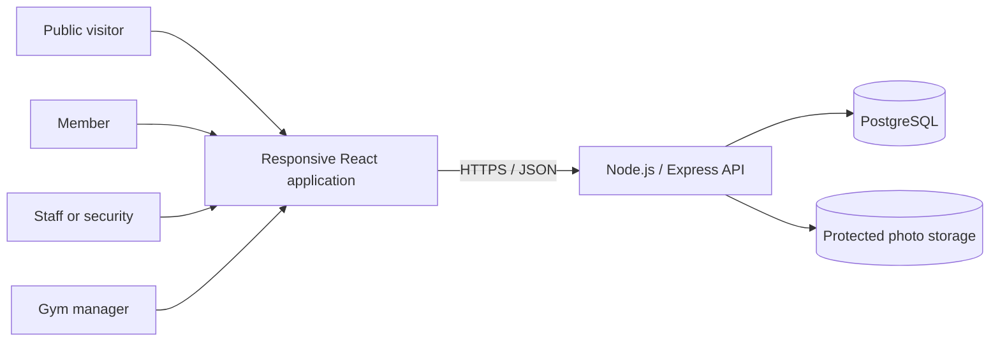
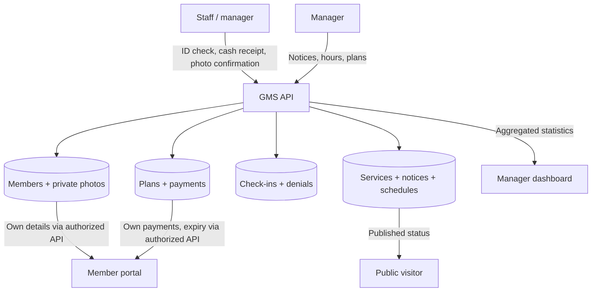

# Gym Management System (GMS)
## Software Requirements Specification (SRS)

**University of Eswatini — Practices in Software Engineering II (CSC491)**  
**Version:** 1.1 — **proposed, for team and client review**  
**Date:** 18 October 2026  
**Repository path:** `docs/SRS.md`  
**Intended readers:** Gym manager and staff, development team, course lecturer, testers

> **Approval and delivery status:** This document is a requirements specification, **not evidence that the system has been built or tested**. It revises the original SRS v1.0 to align with the proposed [Project Plan v3.0](PROJECT_PLAN.md), the revised ER/UML diagrams, and the [PostgreSQL model](../database/ERD.md). Client policy decisions tagged **PENDING** remain recommendations or working assumptions, not approved gym rules. Before the system handles real people or money, the gym manager and team must approve the relevant decisions and update this document and its tests together.

## Document control

| Field | Value |
| --- | --- |
| Document identifier | `GMS-SRS` |
| Source requirements baseline | *Gym_Management_System_SRS.docx* v1.0, 9 October 2026 |
| Related plan | [Revised Project Plan v3.0](PROJECT_PLAN.md), proposed 18 October 2026 |
| Related design | `Gym_Management_System_Diagrams_Revised.docx` (when added to `docs/`), [database ERD](../database/ERD.md) |
| Database implementation reference | `database/01_schema.sql`, `database/02_logic_and_views.sql` (repository paths) |
| Document status | Draft for review; requirements and client acceptance not yet signed off |
| Changes require | GitHub issue, impact review, team agreement, client sign-off when operational rules change |

### Revision history

| Version | Date | Description |
| --- | --- | --- |
| 1.0 | 9 October 2026 | First SRS, based on Project Plan v2.0. |
| **1.1 (proposed)** | **18 October 2026** | Clarifies advance notices, membership/payment-derived expiry, separate account and subscription status, service schedules, denied entry, privacy, priorities and acceptance. Preserves the original 66 `FR-*` identifiers and 14 `NFR-*` identifiers; flags unapproved policies. |

## Contents

1. [Introduction](#1-introduction)
2. [Overall system description](#2-overall-system-description)
3. [External interfaces](#3-external-interfaces)
4. [Use cases](#4-use-cases)
5. [Functional requirements](#5-functional-requirements)
6. [Business rules](#6-business-rules)
7. [Data requirements and integrity](#7-data-requirements-and-integrity)
8. [Non-functional requirements](#8-non-functional-requirements)
9. [Verification and acceptance](#9-verification-and-acceptance)
10. [Traceability](#10-traceability)
11. [Open decisions and assumptions](#11-open-decisions-and-assumptions)
12. [Change control and sign-off](#12-change-control-and-sign-off)

---

## 1. Introduction

### 1.1 Purpose

This SRS defines **what the Gym Management System shall do**, under what constraints, and how it will be verified. It serves as the common reference for client validation, software design, implementation, testing and coursework assessment. Its organization draws on IEEE 830 / ISO/IEC/IEEE 29148 guidance, scaled to a four-person, five-week class project.

**Normative wording:** **shall** means a required, testable behavior; **should** means a lower-priority feature if resources permit. **M** = Must for the agreed release; **S** = Should after Must requirements pass. A provisional rule marked **PENDING** must not be treated as a confirmed client requirement solely because it is described here.

### 1.2 Problem statement and objectives

The proposed client is the University of Eswatini gym, where paper-based member, payment and attendance records make operations difficult. The revised project materials identify two principal problems:

- **Unverified entry:** A visitor may claim to be a member without the entry being tied to a verified person and current membership.
- **Unannounced closures:** Members may travel to the gym without knowing that the gym or an area/service will be unavailable.

The system shall support photo-confirmed entry, reliable subscription/payment records, advance public closure information, a private member portal and manager reports. The descriptions of present gym procedures require confirmation during client requirements review.

### 1.3 Scope

**In scope:** individual staff and manager accounts; member login; in-person member registration against a physical ID; protected member photo; membership plans; recorded **cash-only** payments and renewal; photo-confirmed gym-level check-in and manual checkout; denied-entry logs and history; current and upcoming notices; whole-gym and area-specific hours and one-day overrides; public status page; private member portal; manager dashboard.

**Out of scope for this release:** native mobile app, email/SMS or push notifications, online/card payments, biometric or RFID/card-reader entry, class booking, equipment reservations, integration with existing university systems, and per-plan access permissions for particular gym areas. A responsive website is provided instead of a native app.

### 1.4 References

- Gym Management System — Project Plan v2.0 and proposed [v3.0](PROJECT_PLAN.md).
- Gym Management System — SRS v1.0, 9 October 2026.
- Revised Gym Management System ER/UML diagrams (proposed design).
- [PostgreSQL database ERD](../database/ERD.md) and `database/README.md` (implementation reference, not acceptance evidence).
- IEEE 830-1998; ISO/IEC/IEEE 29148:2018 (requirements-documentation references).

### 1.5 Definitions

| Term | Meaning |
| --- | --- |
| Member | A registered person with a current or past gym subscription. |
| Staff | Front-desk/security worker with an individual staff account. |
| Manager | Authorized user who has staff capabilities plus plans, notices, hours, accounts and reporting administration. |
| Public visitor | Someone browsing public gym status and plans without signing in. |
| Plan | Membership product with a price and duration in calendar days. |
| Subscription / membership validity | Computed from the member's latest confirmed payment and resulting expiry date. |
| Account status | Administrative access/eligibility condition (e.g., `ENABLED` or `SUSPENDED`), distinct from payment-based membership validity. |
| Active / expired subscription | Active through expiry date; expired after it, subject to final day-counting policy. |
| Lapsed member | Person who paid previously but whose membership is currently expired. |
| Gym service / area | Physical area or amenity such as the cardio room; used for schedules and closures, **not** a membership access tier. |
| Notice | Published message affecting the whole gym or one area during a specified date range. |
| Denied attempt | Entry attempt not accepted, stored with a reason and handling staff. |
| FR / NFR / BR | Functional requirement / non-functional requirement / business rule. |
| Confirmed payment | Cash transaction recorded and accepted in the system; not an electronic funds transfer. |

## 2. Overall system description

### 2.1 Product perspective

GMS is a new, independent web application. It has a React frontend, an Express/Node.js REST API, a PostgreSQL database and protected photo-file storage. It does not integrate with an existing gym database, cash register or payment gateway in the initial release.

### 2.2 User classes and permissions

| User | Login | Authorized activities |
| --- | --- | --- |
| Public visitor | None | Read current/upcoming notices, gym/area hours and published plan details. |
| Member | **ID type + ID number + password** | View only their own plan, current expiry, days left, payment history, public notices and hours. |
| Staff | Unique username + password | Register/search members, view protected photos, record cash payments, confirm entry, checkout and view authorized histories. |
| Manager | Unique username + password | All staff functions **plus** create/disable staff users, maintain plans, publish/cancel notices, change schedules and see dashboard/audit information. |

All authorization decisions shall be enforced by the **server**; hiding frontend controls is not access control. Public read access to notices does **not** authorize staff to modify notices.

### 2.3 Operating environment and constraints

- Browser-based frontend on current Chrome, Firefox and Edge; public and member views support phone widths from **360 px**.
- Node.js/Express API and PostgreSQL database on team-selected development/demo hosting.
- Front-desk device has network access and a camera for registration photos; secure file upload is an alternative if photo capture is unavailable.
- Development and tests use fictitious records and non-real photo assets; **no real member IDs or photos** without explicit pilot authorization and safeguards.
- Team: four members; schedule: five development weeks from an agreed kickoff.
- Gym calendar dates and hours are interpreted using **Africa/Mbabane** local time for the current prototype. Confirm operating hours and exceptions with the client.
- The system does not itself receive or process money. Staff attest that cash was received when saving a payment.

### 2.4 Core data and dependencies

The active subscription is derived from **confirmed payment history**, not a manually editable expiry value in a member row. Gym areas are independent of plans; an ordinary subscription is gym-wide until the client approves a different rule. Notices and weekly/one-off schedules may apply to the entire gym or one area.

## 3. External interfaces

### 3.1 User interfaces

| Screen | User | Minimum contents and actions |
| --- | --- | --- |
| Staff/manager sign-in | Staff, manager | Username/password, authentication feedback, logout. |
| Member sign-in | Member | ID type, ID number, password, invalid-attempt/lock feedback. |
| Register member | Staff/manager | Names, accepted ID fields, evidence of physical-ID check, required photo, member password/temporary password, first plan and cash-payment workflow. |
| Search/member record | Staff/manager | Name/ID search, photo, account and subscription status, masked ID where feasible, authorized edit/history. |
| Cash payment/renewal | Staff/manager | Plan selection, old expiry, added days, proposed new expiry, receipt number, confirmation. |
| Check-in | Staff/manager | Search matches with photos, plan and expiry; explicit **Confirm photo match**, denial reason, days-warning, manual checkout. |
| Staff administration | Manager | Create, disable, reset staff account credentials. |
| Plan administration | Manager | Add/edit plan and manage availability for new purchases. |
| Notice/hour management | Manager | Gym/area notice title/message/dates; publish/edit/cancel; weekly hours and date overrides. |
| Public status | Everyone | Today's hours and service status; current **and upcoming** closure notices; published plans; no login. |
| Member portal | Member | Own plan, expiry, days remaining, historical payments, current/upcoming notices and hours; no photo or full ID number. |
| Dashboard | Manager | Active/lapsed/new member counts, weekly/monthly accepted check-in charts, optional additional metrics. |

### 3.2 Hardware and software interfaces

- **Camera/photo:** Browser camera capture or uploaded image; size/type validation and protected server storage. A physical identity document is inspected by staff, **not automatically authenticated by software**.
- **Frontend ↔ API:** JSON REST requests/responses over HTTPS outside local-only development; session/token authentication managed by backend.
- **API ↔ PostgreSQL:** Parameterized SQL, transactions, role-checked operations and restricted database credentials.
- **API ↔ photo storage:** Member photo files are private; protected endpoints are accessible to authorized staff/manager only.
- **Payments:** No external payment provider or card terminal interface.

### 3.3 Error behavior

The interface shall present understandable results for validation failures, duplicate IDs, unavailable plans, expired or suspended members, wrong credentials, forbidden access, payment duplicate receipts and network failures. It shall not expose password hashes, stack traces, internal photo paths, or complete ID numbers in error messages.

## 4. Use cases

### 4.1 Use-case catalogue

| Use case | Actor | Linked requirements |
| --- | --- | --- |
| UC-01 Sign in/out | Staff, manager, member | `FR-AUT` |
| UC-02 Manage staff accounts | Manager | `FR-AUT-04`–`07` |
| UC-03 Register member | Staff/manager | `FR-MEM`, `FR-PAY` |
| UC-04 Admit member to gym | Staff/manager | `FR-CHK`, `FR-HIS` |
| UC-05 Check out member | Staff/manager | `FR-CHK-08`/`09` |
| UC-06 Collect cash / renew | Staff/manager | `FR-PAY`, `FR-PLN` |
| UC-07 Manage plans | Manager | `FR-PLN` |
| UC-08 Publish/edit/cancel notice | Manager | `FR-NOT`, `FR-PUB` |
| UC-09 Maintain weekly hours and overrides | Manager | `FR-NOT-04`–`07` |
| UC-10 View public gym status | Everyone | `FR-PUB` |
| UC-11 View own subscription | Member | `FR-POR`, `FR-AUT-08`/`09` |
| UC-12 View dashboard | Manager | `FR-DSH` |
| UC-13 Review member/payment/entry history | Staff/manager | `FR-HIS` |

### 4.2 UC-03 — Register a member

**Preconditions:** staff signed in; visitor physically present; accepted identity document available.

1. Staff inspect physical ID, then enter first name, surname, ID type and ID number.
2. Staff capture/upload a photo taken for registration and compare it with the visitor.
3. The system rejects a duplicate `(id_type, id_number)` or missing photo; no record is saved on failure.
4. The visitor chooses a password, or receives a temporary password that must be changed at first login.
5. Staff choose a plan and complete the **cash-payment confirmation** workflow.
6. On success, the member account, first payment and calculated expiry are saved; the initial workflow is atomic.

**Alternative:** If identity cannot be verified, staff abandon the registration. If cash/payment confirmation is cancelled, the initial combined registration is not marked as a paid subscription; its persistence policy must be consistently implemented. **Postcondition:** verified member record with protected photo; payment/expiry if cash payment was confirmed.

### 4.3 UC-04 — Check in a member

**Preconditions:** staff signed in; visitor present; member lookup supplied by name/ID.

1. Staff search; system displays matching records with photo, name, account status, plan and expiry; same-name results remain distinguishable.
2. Staff compare the visitor with the protected photo and explicitly press **Confirm** only on a match.
3. Server checks that the member account is enabled, the membership is currently valid and no other visit is open.
4. If valid and confirmed, server saves check-in time and confirming staff account.
5. If fewer than 10 days remain, show warning and staff inform the member.

**Alternatives:** no matching identity → `UNKNOWN_ID`; mismatch/no photo confirmation → `PHOTO_NOT_CONFIRMED`; expired → `EXPIRED`; suspended → `SUSPENDED`; already inside → `ALREADY_INSIDE`. Each attempted, rejected check-in is logged with its reason and handling staff; **no successful visit is created**. **Postcondition:** exactly one successful new entry or a recorded denial.

### 4.4 UC-06 — Cash payment and renewal

**Preconditions:** staff signed in; registered member and available plan identified; staff have received cash.

1. Staff select member and plan; system shows price, current expiry, duration and computed proposed expiry.
2. Staff enter or obtain a **unique receipt number** (generation method awaiting client confirmation).
3. Staff explicitly confirm cash received and the renewal.
4. Server validates the account, receipt uniqueness and allowed plan, and saves a **single immutable payment record** with staff actor, price snapshot and resulting expiry in one transaction.
5. Portal/dashboard derive current membership data from confirmed payment history.

**Alternatives:** cancelled confirmation → no payment saved; duplicate receipt → safe retry for the same payment or rejected conflict; expired/new subscription → new-period calculation; active subscription → stacking calculation. **Postcondition:** paid days added once, without requiring a new member registration.

### 4.5 UC-08 — Publish closure information

**Preconditions:** manager signed in.

1. Manager chooses whole gym or a gym area, a notice title/message and start/end dates.
2. Manager publishes the notice, with manager identity and publication time recorded.
3. **Immediately on publication**, the public page and member portal show an announcement marked **UPCOMING** if its start date is later than today, or **IN EFFECT** if the date interval includes today.
4. The notice stops displaying after its end date and disappears if cancelled; edits update the published views.

**Important:** *notice visibility* and *closure effective dates* are separate concepts. This change fixes the original contradiction where tomorrow's closure would not be visible until tomorrow. It remains a proposed clarification until approved.

### 4.6 UC-09 — Change hours; UC-11 — View own membership

**UC-09:** Manager edits gym/area weekly hours or enters a one-date override; the override takes precedence for that scope on that date. A **whole-gym closure** takes priority over individual service hours. Every change records its manager actor and time.

**UC-11:** Member signs in with ID type, number and password. The server returns only that member's payment-derived plan, expiry, remaining days, payment history, schedule and notices. The portal displays a warning for fewer than 10 days or expiry. Five consecutive incorrect passwords temporarily lock the member account.

## 5. Functional requirements

All requirements below retain the identifiers from SRS v1.0 for traceability. Entries are **normative proposed v1.1 wording** and do not imply code completion. Unless explicitly marked **S**, priority is **M**. Where interpretation changed, Section 11 identifies client approval needs.

### 5.1 Authentication and access (`FR-AUT`)

| ID | Pri. | Requirement |
| --- | :---: | --- |
| FR-AUT-01 | M | The system **shall** require authentication before staff and manager operations. |
| FR-AUT-02 | M | Every staff and manager user **shall** have an individual, unique username and password. |
| FR-AUT-03 | M | Passwords **shall** be stored as secure one-way hashes and **shall never** be returned or displayed. |
| FR-AUT-04 | M | The manager **shall** create a staff account with a unique username and initial credential. |
| FR-AUT-05 | M | The manager **shall** be able to disable a staff account and reset its password; disabled accounts **shall** be unable to sign in. |
| FR-AUT-06 | M | Actions subject to staff accountability **shall** record the individual authenticated staff/manager actor; the system **shall not** use a shared application account. Credential sharing remains an operational policy issue. |
| FR-AUT-07 | M | Server-side authorization **shall** prevent staff from accessing manager-only modifications, dashboard data and staff administration. |
| FR-AUT-08 | M | Members **shall** log in using **ID type, ID number and password**, independently of staff accounts. |
| FR-AUT-09 | M | Following **five consecutive** incorrect member passwords, the system **shall** temporarily lock member sign-in and indicate the lock without exposing private data. Duration is **PENDING**. |
| FR-AUT-10 | S | Users **should** be able to log out explicitly and be logged out after a defined inactive period. |

### 5.2 Member registration and records (`FR-MEM`)

| ID | Pri. | Requirement |
| --- | :---: | --- |
| FR-MEM-01 | M | Staff **shall** register first name, surname, ID type and ID number after checking the person's physical ID. |
| FR-MEM-02 | M | Accepted ID types **shall** be student ID, national ID, passport and birth certificate, subject to the minor-eligibility decision. |
| FR-MEM-03 | M | The system **shall** reject registration if the **combination** `(id_type, id_number)` already exists. |
| FR-MEM-04 | M | The system **shall** require a protected member photo captured or provided during registration before saving a completed member registration. |
| FR-MEM-05 | M | A member **shall** choose a password or receive a temporary password that must be changed at first login. |
| FR-MEM-06 | M | For each confirmed membership payment, the system **shall** retain the plan, payment date and resulting expiry, and derive the member's **current** plan/expiry from confirmed payment history rather than a second editable member expiry. |
| FR-MEM-07 | M | Authorized staff **shall** search by name or ID number and view/edit permitted member details. |
| FR-MEM-08 | M | Search/check-in **shall** label expired subscriptions and warn when fewer than **10 days** remain. |
| FR-MEM-09 | M | The system **shall not** hard-delete members through the application; authorized staff **shall** be able to set account status (`ENABLED`/`SUSPENDED`) **separately** from computed active/expired subscription state. |
| FR-MEM-10 | S | The system **should** mask full identity numbers on nonessential staff displays while allowing authorized registration/search workflows; member/public views must never expose full IDs. |

### 5.3 Membership plans (`FR-PLN`)

| ID | Pri. | Requirement |
| --- | :---: | --- |
| FR-PLN-01 | M | The manager **shall** add/edit membership plans with name, non-negative price and positive whole-number duration in days. |
| FR-PLN-02 | S | A plan already used in payments **should** be retired from new sales rather than deleted, to retain historical payment references. |

### 5.4 Cash payment and renewal (`FR-PAY`)

| ID | Pri. | Requirement |
| --- | :---: | --- |
| FR-PAY-01 | M | Authorized staff **shall** record an in-person **cash** payment against a member and selected plan; the system shall not accept card/online payment methods. |
| FR-PAY-02 | M | Renewal **shall** reuse the existing member record, with no repeat registration required. |
| FR-PAY-03 | M | If the subscription is active on the payment date, new expiry **shall** equal the existing expiry **plus the purchased plan's duration**. |
| FR-PAY-04 | M | If no active subscription exists, new expiry **shall** be calculated from the cash payment date and plan duration using the **approved** calendar-day convention (current provisional formula in BR2). |
| FR-PAY-05 | M | Before confirmation, the UI **shall** display previous expiry, duration added and proposed new expiry. |
| FR-PAY-06 | M | Each cash payment **shall** be an individually identifiable historical record containing member, plan, amount snapshot, payment date/time, unique receipt, recording staff and resulting expiry. A confirmed payment **shall not** be silently edited or hard-deleted. |
| FR-PAY-07 | M | A single reviewed server/database calculation **shall** govern expiry updates, with transactional consistency and safe handling of repeated payment submission. |

### 5.5 Check-in and checkout (`FR-CHK`)

| ID | Pri. | Requirement |
| --- | :---: | --- |
| FR-CHK-01 | M | Authorized staff **shall** search for an entering member by name or ID number. |
| FR-CHK-02 | M | Each match **shall** show photo, name, plan and subscription/account status; multiple same-name matches **shall** remain distinguishable with photos. |
| FR-CHK-03 | M | A successful gym check-in **shall** require an explicit authenticated staff **Confirm** action following face-to-photo comparison; knowing the name or ID alone is insufficient. |
| FR-CHK-04 | M | Each successful entry **shall** record the check-in timestamp and confirming staff account. |
| FR-CHK-05 | M | The system **shall** refuse gym entry when the membership is expired and **shall** offer the renewal workflow. |
| FR-CHK-06 | M | The system **shall** refuse a second check-in while that member has an unclosed visit. |
| FR-CHK-07 | M | The system **shall** refuse entry when the supplied identity cannot be matched to a member. |
| FR-CHK-08 | M | Staff **shall** be able to check out a member who currently has an open visit and record the exit time and staff actor. |
| FR-CHK-09 | S | The system **should** automatically close outstanding gym visits at the approved gym closing time, recording them as automated rather than pretending a staff member performed checkout. **Priority/policy PENDING.** |
| FR-CHK-10 | S | Following successful check-in, the screen **should** display remaining paid membership days; the fewer-than-10-days warning in `FR-MEM-08`/`BR6` remains mandatory. |

### 5.6 History and denied-attempt logging (`FR-HIS`)

| ID | Pri. | Requirement |
| --- | :---: | --- |
| FR-HIS-01 | M | The system **shall** preserve member, confirmed payment, check-in and denied-attempt history without ordinary application hard-deletion, including for expired members. Retention and lawful deletion require an approved deployment policy. |
| FR-HIS-02 | M | Authorized staff/manager **shall** retrieve a member's payment and entry histories. |
| FR-HIS-03 | M | Each refused entry attempt **shall** be recorded with timestamp, entered identifier, reason (`EXPIRED`, `UNKNOWN_ID`, `PHOTO_NOT_CONFIRMED`, `ALREADY_INSIDE`, `SUSPENDED`), handling staff and linked member when known. |
| FR-HIS-04 | M | The manager **shall** be able to review denied-attempt logs, subject to access controls for personal information. |

### 5.7 Notices and operating hours (`FR-NOT`)

| ID | Pri. | Requirement |
| --- | :---: | --- |
| FR-NOT-01 | M | The manager **shall** publish a gym-wide or area-specific notice with title/message, start date and end date; dates **shall** be ordered correctly. |
| FR-NOT-02 | M | The manager **shall** edit/cancel notices; a published notice **shall** be visible promptly on public/member pages even if its **effective** start date is in the future, labelled appropriately. |
| FR-NOT-03 | M | A published notice **shall** stop appearing after its end date or cancellation, with its historical record retained. |
| FR-NOT-04 | M | The manager **shall** set a regular weekly opening schedule for the entire gym and for individual gym areas/services. |
| FR-NOT-05 | M | The manager **shall** enter a one-date schedule override or closure that takes precedence over the weekly hours for that scope on that date only. |
| FR-NOT-06 | M | Publication/cancellation/editing of notices and hour changes **shall** record the acting manager and change time in history/audit data. |
| FR-NOT-07 | M | Server-side authorization **shall** restrict notice creation/edits/cancellations and schedule modifications to managers. Public **reading** remains allowed. |

### 5.8 Public status page (`FR-PUB`)

| ID | Pri. | Requirement |
| --- | :---: | --- |
| FR-PUB-01 | M | A page available without login **shall** show today's whole-gym and relevant area opening hours/status, accounting for date overrides. |
| FR-PUB-02 | M | The public page **shall** show currently effective **and announced upcoming** notices, identifying the affected gym or area and the effective dates. |
| FR-PUB-03 | M | The public page **shall** show available plans with name, price and duration. |
| FR-PUB-04 | M | The public page **shall** be usable on a phone-sized display. |

### 5.9 Member portal (`FR-POR`)

| ID | Pri. | Requirement |
| --- | :---: | --- |
| FR-POR-01 | M | A signed-in member **shall** see their own plan, expiry date, remaining days and payment history derived from confirmed payments. |
| FR-POR-02 | M | The portal **shall** show current/upcoming notices and gym/area operating hours, without needing an additional manager login. |
| FR-POR-03 | M | The portal **shall** display a warning when fewer than 10 days remain, and a distinct expired state when no paid days remain. |
| FR-POR-04 | M | The server **shall** prevent members from requesting any other member's record or photos; portal responses **shall not** include photos or full ID numbers. |
| FR-POR-05 | M | The member portal **shall** be usable on a phone-sized display. |

### 5.10 Manager dashboard (`FR-DSH`)

| ID | Pri. | Requirement |
| --- | :---: | --- |
| FR-DSH-01 | M | Only a manager **shall** be able to obtain dashboard data. |
| FR-DSH-02 | M | The dashboard **shall** count members with a currently active paid subscription (independent of account suspension; eligibility is a separate status). |
| FR-DSH-03 | M | It **shall** count lapsed members who have previously purchased a plan but whose subscription has expired. |
| FR-DSH-04 | M | It **shall** graph **successful accepted check-ins**, excluding denials, aggregated by week and by month. |
| FR-DSH-05 | M | It **shall** count new member records created during the current calendar month. |
| FR-DSH-06 | M | Figures **shall** be calculated from current database records when opened/refreshed; they shall not be manually maintained totals. |
| FR-DSH-07 | S | The dashboard **should** show subscriptions expiring within 10 days and a peak-hours attendance chart. |

**Scope/priority count:** **66 functional requirements**: 60 **Must**, 6 **Should**. `FR-CHK-09` remains **Should** here to match the original SRS, despite the original Project Plan v2 “Done when” wording; this needs formal priority approval.

## 6. Business rules

The original SRS includes `BR1`–`BR8`. The descriptions below preserve their purpose while spelling out needed database and acceptance semantics.

| ID | Rule | Approval status |
| --- | --- | --- |
| BR1 | A subscription is currently active if the latest confirmed payment's resulting expiry is **today or later**, using the gym's calendar date; otherwise it is expired. Account suspension is a **separate** eligibility condition. | Original baseline; account distinction proposed clarification |
| BR2 | Plan days **stack** when renewing an active subscription; expired/new subscriptions start from payment date. **Proposed inclusive-day convention:** for a new/expired plan, `expiry = payment_date + (duration_days - 1)`; for active renewal, `expiry = previous_expiry + duration_days`; `days_left = max(0, expiry - today + 1)`. | **PENDING D-07**; original SRS literally used `payment_date + duration_days` |
| BR3 | A member is identified uniquely by `(id_type, id_number)`; members authenticate using both and a password. | Original baseline |
| BR4 | Check-in requires staff's explicit photo-match confirmation, not merely a member name or ID. | Original baseline |
| BR5 | Member, confirmed-payment, check-in and denied-entry history is retained against normal app deletion; lawful retention/deletion and privacy require a client-approved pilot policy. | Original baseline; deployment policy **PENDING** |
| BR6 | With **fewer than 10** paid days left, show a warning on staff check-in and member portal; staff advise the member after verifying identity. | Original baseline |
| BR7 | Staff collect **cash** at the desk and record every payment with receipt, actor and resulting expiry. | Original baseline; receipt issuance **PENDING D-04** |
| BR8 | Staff and managers have individual authenticated accounts; auditable operations identify the responsible person. | Original baseline |

**Additional design clarifications (not new approved business rules):**

- **Notice lifecycle (D-08):** `PUBLISHED + future start → UPCOMING`, `PUBLISHED + current date inside interval → IN EFFECT`, `CANCELLED or after end → not shown publicly`. A closure must be visible **before** it starts if published earlier.
- **Entry eligibility:** member account `ENABLED` **and** active subscription **and** photo confirmed **and** no open visit. Rejected entry must not create a check-in.
- **Services and schedules (D-03/D-09):** a null service scope denotes the whole gym; otherwise schedule/notice applies to one area. Whole-gym closure overrides individual area hours. No plan–area permissions are assumed.
- **Receipts:** every confirmed payment uses a globally unique receipt; whether staff enter a gym-issued number or software generates one is unresolved.
- **Concurrent saves:** renewal and entry operations must be transactional; repeated identical payment submissions must not create duplicate paid days.

### Illustrative date examples (proposed inclusive policy only)

| Scenario | Expected result if D-07 is approved |
| --- | --- |
| Buy a 30-day plan on 1 November | Last valid date is **30 November**; payment date counts as Day 1. |
| Renew 30 days with 8 days left | **38 calendar days** remain on the renewal date. |
| Renew a subscription that expired yesterday with a 30-day plan today | **30 calendar days** remain starting today. |
| Attempt to check in on the expiry date | Allowed if account is enabled and photo confirmed. |
| Attempt to check in the day after expiry | Refused and denial logged. |

The exact date convention **must be approved before real cash payments**; the existing database scripts use the proposed inclusive rule.

## 7. Data requirements and integrity

### 7.1 Logical data dictionary

The schema below describes the current **proposed implementation**. Primary/foreign keys, datatypes and index constraints are detailed in `database/01_schema.sql`; code review and runtime testing are still required.

| Entity | Main fields / relationships | Integrity and confidentiality |
| --- | --- | --- |
| `staff_accounts` | ID, username, password hash, STAFF/MANAGER role, enabled flag, timestamps | Unique username; no shared login; manager-only management. |
| `members` | ID, names, ID type/number, protected photo path, password hash, failed attempts/lock, `ENABLED`/`SUSPENDED`, registration date | Unique `(id_type, id_number)`; photo required; minor/guardian fields optional pending policy. |
| `plans` | ID, name, price, duration days, available-for-sale flag | Positive duration, nonnegative price; retain referenced plans. |
| `payments` | ID, member, plan, date, receipt, amount, CASH method, confirmed status, staff actor, resulting expiry | Unique receipt; single confirmed record per transaction; immutable history; latest confirmed payment determines current subscription. |
| `checkins` | ID, member, entry time, confirmed-by staff, photo-confirmed flag, exit time/actor/method | One open check-in per member; no accepted visit without positive photo confirmation. |
| `denied_attempts` | ID, entered identifier, optional member, reason, timestamp, staff actor | Append-only; staff-only access; avoid writing full identifiers to ordinary logs. |
| `services` | ID, service/area name, description, active flag | An area is **not** restricted to a particular plan. |
| `notices` | ID, optional area, title/message, start/end date, publish/cancel state, poster/editor, timestamps | Public read of published, non-cancelled, non-expired notices; manager-only edit; keep history. |
| `operating_times` | ID, optional area, weekday, opening/closing or closed, changing manager | One schedule per gym/area and weekday; enforce valid hours. |
| `time_overrides` | ID, optional area, specific date, hours/closed, reason, changing manager | One override per gym/area and date; takes precedence over weekly hours. |
| `audit_events` | ID, manager actor, action, target entity/ID, details, timestamp | Preserve notice/hour modification history; restricted access. |

No separate editable current-expiry field on `members` is required. The latest confirmed **payment** provides the current plan and expiry. Dashboard totals are derived queries, not stored counters. A gym check-in does not need a service/area foreign key.

### 7.2 Security and transaction constraints

1. **Identity:** database uniqueness constraint for `(id_type,id_number)`; server validation of incoming IDs and photo uploads.
2. **Payments:** receipt uniqueness; confirmed cash-payment data retained; amount fixed at confirmation; transaction and retry behavior avoid doubled days.
3. **Attendance:** partial uniqueness ensuring a member cannot have two simultaneous open visits; confirmation and eligibility checked again server-side.
4. **Audit:** staff/manager ID derived **server-side from authenticated credentials**, never trusted from arbitrary request data.
5. **Authorization:** protected member photos and identity data are not publicly served; member API queries scoped to the authenticated member's own ID.
6. **Privacy:** application data is test-only until policy approval; no raw member identity data, credentials, database backups or photos in GitHub.
7. **Deployment:** use restricted PostgreSQL application credentials, HTTPS, input validation, transactions, backups and controlled error output.

### 7.3 Data flow

The diagram is conceptual: all reading/writing passes through authorized application endpoints. Public visitors cannot query database tables or private storage directly.

## 8. Non-functional requirements

| ID | Category | Requirement and verification target |
| --- | --- | --- |
| NFR-01 | Performance | Search and display of matching member photo/status **shall** complete in **under 2 seconds**, measured under test load of up to **5 concurrent staff users** and **50 member searches per minute**. Measure system time, not physical ID inspection. |
| NFR-02 | Performance | Public status page **shall** load in **under 3 seconds** on the team's agreed representative phone/network test profile; record device, browser, connection and sample results. Network profile awaits test-plan agreement. |
| NFR-03 | Security | Passwords **shall** be hashed using an accepted password-hashing scheme, and staff/manager authorization **shall** be checked on the server on every protected request. |
| NFR-04 | Security | An authenticated member **shall not** retrieve another member's data, even by changing record IDs or calling API routes directly. |
| NFR-05 | Security | The deployed application **shall** use HTTPS; localhost-only development may use local HTTP. |
| NFR-06 | Privacy | Full ID numbers and photos **shall** be accessible only to authorized staff/manager; photo paths/files shall not be publicly accessible; public pages, reports and member portal shall not disclose full identifiers/photos. |
| NFR-07 | Usability | Following approximately **15 minutes of guidance**, a new staff tester **shall** be able to register a member and check one in without consulting a manual. Record successful steps and errors. |
| NFR-08 | Responsiveness | Public status and member pages **shall** remain usable at **360 px viewport width** and above, without losing core actions/content. |
| NFR-09 | Reliability | Payment and check-in saves **shall** be atomic: refresh/connection interruption shall not leave partial database records. Retried payment confirmation **shall not** double-count days; uncertain responses must be checked by receipt/status rather than blindly repeated. |
| NFR-10 | Backup | Development database **shall** be backed up at least **weekly** and before demonstration; one restore check should be recorded. |
| NFR-11 | Compatibility | Common workflows **shall** work on current Chrome, Firefox and Edge versions used by the team, with version evidence recorded during testing. |
| NFR-12 | Maintainability | Code **shall** be organized by modules, use documented API contracts and be reviewed through GitHub pull requests before merging. |
| NFR-13 | Accuracy | Expiry calculations **shall** pass boundary and stacking examples under the **approved** BR2 day-counting convention. Do not claim acceptance until D-07 is signed off. |
| NFR-14 | Availability | For an actual gym pilot, the deployed system **shall** be available during approved gym operating hours, and planned downtime shall be announced. Hosting/SLA measures need pilot agreement; this is **not** a claim of demonstrated uptime. |

**Security boundary:** PostgreSQL constraints help maintain integrity but do not substitute for authentication, role checks, rate limiting, staff-photo comparison, or backend validation. No system can guarantee a staff member actually compared the person correctly merely because they pressed Confirm.

## 9. Verification and acceptance

### 9.1 Test strategy

- **Unit:** membership date rules, warnings, account lock and schedule/notice state calculations.
- **Database:** uniqueness constraints, referential integrity, concurrent renewal, one-open-visit rule, immutable payment/history operations.
- **API/integration:** session/role boundaries, registration + initial payment transaction, payments, check-ins/denials, notices and portal/dashboard reads.
- **System/UI:** complete staff, manager, member and public workflows across desktop and phones.
- **Security/privacy:** unauthorized manager actions, member cross-account access, private-photo routes, injection-safe inputs, login failure/lock behavior.
- **Performance/usability:** `NFR-01`/`02`, `NFR-07`/`08`, browser compatibility and navigation.
- **Regression:** rerun affected tests after fixing any defect.

### 9.2 Acceptance test catalogue

Use these IDs as GitHub issue/test-case labels. Each requirement still needs an explicit pass/fail execution record; a written test case is **not** evidence of success.

| Test ID | Requirement coverage | Test / expected result |
| --- | --- | --- |
| AT-01 | AUT-01–07, DSH-01, NOT-07 | Staff access to manager dashboard, account administration or notice editing is rejected by the **API**, not merely hidden by UI. Disabled staff login fails. |
| AT-02 | AUT-08–09 | Member signs in using ID type+number+password; **5** consecutive wrong passwords produce temporary lock. |
| AT-03 | MEM-01–05 | Member cannot register without approved ID fields or photo; duplicate ID type+number is rejected; accepted member has protected photo/hash. |
| AT-04 | MEM-06–09, HIS-01–02 | Member's current plan/expiry matches latest confirmed payment; suspended status is separate; old payment/visit data remains visible to authorized staff. |
| AT-05 | PLN-01, PUB-03 | Manager creates a valid plan; public can see correct available name/price/duration; invalid duration is rejected. |
| AT-06 | PAY-01–07, BR1–2 | New 30-day plan uses approved expiry rule; active renewal with 8 days left adds 30 to reach 38 days; expired renewal starts a new period; preview matches record. |
| AT-07 | PAY-06–07, NFR-09 | Repeating the **same** receipt confirmation does not create two payments; a receipt used by a different transaction is rejected; failed transaction leaves no partial payment. |
| AT-08 | CHK-01–04, BR4 | Name/ID lookup alone cannot admit; explicit photo confirmation by logged-in staff creates exactly one staff-attributed check-in. |
| AT-09 | CHK-05–07, HIS-03 | Expired, unknown, suspended, mismatched-photo and already-inside attempts are rejected and logged with correct reasons/actors. |
| AT-10 | CHK-08, HIS-02 | Manual checkout closes open visit once, records time/actor, and later new check-in can succeed. |
| AT-11 | MEM-08, POR-03, BR6 | 9 days remaining shows warning at check-in and portal; expired membership shows expired state. |
| AT-12 | NOT-01–03, PUB-01–02 | A tomorrow closure published today is visible **today as upcoming**; it becomes in effect on start, disappears after end, and disappears if cancelled. |
| AT-13 | NOT-04–06, PUB-01 | One-day gym/area override replaces normal hours for that day only; gym-level closure overrides area display; manager action audited. |
| AT-14 | POR-01–05, NFR-04/06 | Member A cannot view B's plan/payment details or photo by changing API ID. Portal omits photo/full ID and works on phone. |
| AT-15 | DSH-02–07 | Current active/lapsed/new member totals and weekly/monthly **accepted** visit charts match known seeded data; denied attempts are excluded. |
| AT-16 | NFR-01/02/07/08/11 | Record repeatable performance timing under stated load, phone width checks, browser results and 15-minute trained user task outcomes. |
| AT-17 | NFR-05/09/10/12/14 | Verify deployed HTTPS, atomic transaction/retry behavior, weekly backup + restore check, modular review and availability plan. |
| AT-18 | AUT-10, MEM-10, PLN-02, CHK-09/10, DSH-07 | Test implemented **Should** functionality separately, without blocking a Must-only release unless the approved priority changes. |

### 9.3 Acceptance criteria and release gate

A **Must** requirement is accepted only when (1) wording and dependencies are approved, (2) backend/database and UI behavior exist, (3) corresponding normal/failure tests have recorded passing evidence, (4) access/security checks pass, and (5) the integrated workflow is demonstrable. For a client-facing rule marked **PENDING**, approval and updated tests are prerequisites. **Should** features are reported as implemented/tested or deferred, not silently treated as Must.

## 10. Traceability

### 10.1 Original problem → requirements

| Project problem/objective | Requirement groups |
| --- | --- |
| Identity fraud at entry | `FR-MEM`, `FR-CHK`, `FR-HIS-03`, `FR-AUT`, `BR3`, `BR4` |
| Members uninformed about closures | `FR-NOT`, `FR-PUB`, `FR-POR-02` |
| Paper member/payment records and wrong expiry | `FR-MEM`, `FR-PLN`, `FR-PAY`, `FR-HIS`, `BR1`, `BR2`, `BR5`, `BR6` |
| No managerial attendance overview | `FR-DSH`, `FR-HIS` |
| Staff accountability and member privacy | `FR-AUT`, `FR-CHK-04`, `FR-PAY-06`, `FR-NOT-06`, `FR-POR-04`, `NFR-03`–`06`, `BR8` |

### 10.2 Plan requirements → SRS → verification

| Plan v2/v3 ID | SRS group | Primary tests |
| --- | --- | --- |
| R1 — Accounts and access | `FR-AUT-01`–`07`, `FR-AUT-10` | AT-01, AT-17, AT-18 |
| R2 — Notices and operating hours | `FR-NOT`, `FR-PUB-01`/`02` | AT-12, AT-13 |
| R3 — Member registration | `FR-MEM` | AT-03, AT-04, AT-11 |
| R4 — Plans and member portal | `FR-PLN`, `FR-PUB-03`/`04`, `FR-POR`, `FR-AUT-08`/`09` | AT-02, AT-05, AT-14 |
| R5 — Payment and renewal | `FR-PAY` | AT-06, AT-07 |
| R6 — History and denied entry | `FR-HIS`, `FR-MEM-09` | AT-04, AT-09, AT-10 |
| R7 — Check-in and checkout | `FR-CHK` | AT-08–11, AT-18 |
| R8 — Manager dashboard | `FR-DSH` | AT-01, AT-15, AT-18 |

### 10.3 Original SRS v1.0 → proposed v1.1 notable changes

| Area | Why this wording was updated |
| --- | --- |
| Advance notices (`UC-08`, `FR-NOT-02`, `FR-PUB-02`) | A closure published for tomorrow must be visible today, not only on its start date. |
| Membership expiry (`FR-MEM-06`, `FR-PAY`, `BR2`) | Single authoritative expiry derives from payment history; inclusive date formula remains **pending approval**. |
| Account status (`FR-MEM-09`, `FR-CHK`, `FR-DSH-02`) | Administrative suspension is distinct from paid/expired subscription status. |
| Check-out (`FR-CHK-09`) | Marked Should per SRS v1.0, pending formal reconciliation with Plan v2 mandatory completion criteria. |
| Member authentication (`FR-AUT-08`) | Require ID **type** as well as ID number and password consistently across plan, use cases and screens. |
| Receipt (`FR-PAY-06`) | Unique per payment; generation vs supplied receipt remains an explicit unresolved decision. |
| Minor registration (`FR-MEM-02`) | Allowed document types are preserved; guardian/consent policy not silently settled. |
| Gym services (`FR-NOT`) | Areas determine notice/schedule scope, not membership-plan access privileges. |

## 11. Open decisions and assumptions

**Client approval is required.** Each decision is tracked in [Project Plan v3.0, §13](PROJECT_PLAN.md#13-open-decisions-and-approvals). Update all affected documents once answered.

| ID | Decision | Current provisional position | Affected requirements |
| --- | --- | --- | --- |
| D-01 | Are under-18 registrations permitted? Guardian consent/details? | Undecided; optional fields only. Do not enforce a guessed rule. | MEM-01/02, privacy/registration |
| D-02 | Maximum allowable advance purchase days? | Existing SRS default has no limit; **not approved**. | PAY-03/04 |
| D-03 | Actual gym/area hours, services, closing and closure procedures? | Manager will supply values; no invented times. | NOT-04/05, PUB, CHK-09 |
| D-04 | Gym-provided vs system-generated receipt numbers? | Must be unique; generation method unresolved. | PAY-05/06 |
| D-05 | Which staff may view personal photos/full IDs, and what is their retention policy? | Staff/manager only in original SRS; validate client/privacy obligations. | MEM, HIS, POR, NFR-06 |
| D-06 | Should auto-checkout be mandatory? What closing time applies? | **S**, per SRS v1.0, until approved otherwise. | CHK-09, design/schedule |
| D-07 | Is payment date counted as Day 1 of a calendar-day plan? | **Proposed inclusive** date rule in BR2/SQL; not approved. | PAY-03/04/07, BR1/02, NFR-13 |
| D-08 | Are upcoming published closures visible immediately? | **Proposed yes** with UPCOMING label; requires acceptance confirmation. | NOT-01/03, PUB-02 |
| D-09 | Can every valid member use every area regardless of plan? | Proposed yes; no plan–service table. | Scope, plans, data model |
| D-10 | Confirm course code, team member details and start/submission dates. | Revised documents use CSC491; initial plan used CSC392. | Document control and plan |
| D-11 | Member-account lock duration and idle timeout? | Original requires a “short time”; database example uses 15 minutes, **not yet approved**. | AUT-09/10 |
| D-12 | Overnight hours, retention after deployment, and notification expectations? | Overnight hours and external push notifications not included in current database/release; discuss before real pilot. | NOT, NFR-14, privacy |

The **existing PostgreSQL schema and functions implement some proposed decisions** (notably inclusive date counting and 15-minute lock). An implementation choice does not, by itself, constitute client approval. If the client chooses differently, update the SRS, database migration/functions, UML/ER diagrams and test data together.

## 12. Change control and sign-off

1. Record a request in a GitHub Issue with affected `FR-*`, `NFR-*`, `BR*` and plan `R*` identifiers.
2. Explain the problem, proposed wording, impact on database/API/UI, security, schedule, acceptance tests and dependencies.
3. Team Manager coordinates team review; gym management explicitly confirms changes to operational rules and data handling.
4. Update `docs/SRS.md`, `docs/PROJECT_PLAN.md`, relevant diagram/database scripts and test cases **in the same reviewed change** when practical.
5. Preserve requirement identifiers where the original purpose is unchanged; use a new ID/version history when adding genuinely new required behavior.
6. Store decision evidence in meeting notes or an optional `docs/decisions.md`. Do not claim tests or client approval without evidence.

| Approver | Status | Date / evidence |
| --- | --- | --- |
| Team Manager | **Pending review** | — |
| System Architect | **Pending review** | — |
| Gym manager / client | **Pending validation** | — |
| Lecturer / coursework reviewer (if required) | **Pending** | — |

---

**Source note:** This is a consolidated Markdown revision of the supplied SRS v1.0, Project Plan v2 and proposed v3, revised UML/ER models, and PostgreSQL scripts. Unresolved points are clearly marked rather than presented as factual client approvals. It specifies planned behavior and verification only; it does not assert that the application, database tests, hosting or final acceptance have succeeded.
