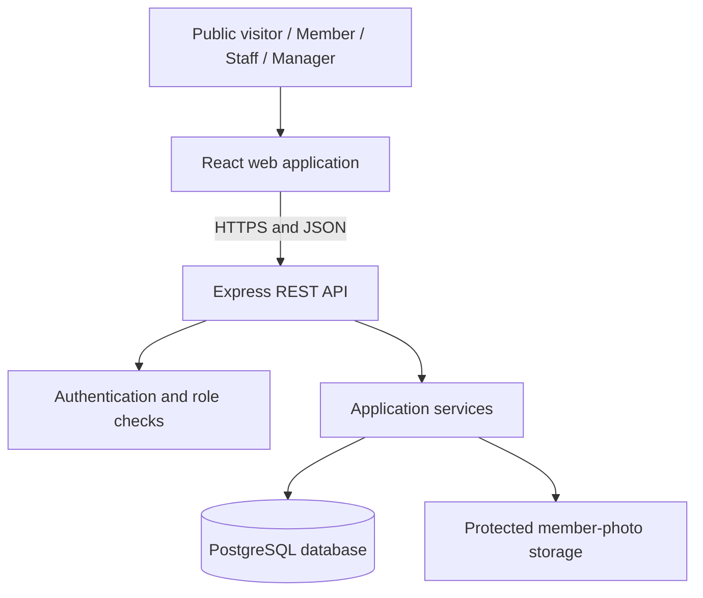

# Gym Management System (GMS)

**University of Eswatini | Practices in Software Engineering II (CSC491)**  
**Team:** 4 members &nbsp;·&nbsp; **Project duration:** 5 weeks &nbsp;·&nbsp; **Platform:** Web application

> **Project status:** Requirements and initial system-design documentation have been prepared. The revised ER and UML diagrams are a **proposed design baseline**, not final client approval. An interactive UI prototype and focused functional checks are available under `GMS/UI`. Backend integration, production authentication, and end-to-end acceptance have **not yet been verified**.

## Interactive UI prototype

The **Gymflow** interface is available in [GMS/UI](UI/README.md). It includes front-desk, manager, member, and public views, with member registration, cash renewals, photo-confirmed entry, checkout, notices, operating hours, and attendance reports.

From the repository root, serve the interface with Python 3:

```bash
cd GMS/UI
python3 -m http.server 8000 --directory dist
```

Open [http://localhost:8000](http://localhost:8000). Use **Preview as** to explore the four roles. To run the focused checks from `GMS/UI`, use Node.js 18 or later:

```bash
node tests/check-workflows.mjs
```

The prototype uses HTML, CSS, JavaScript, and browser-local sample data. The planned React/Express/PostgreSQL application is not yet connected to it. Role preview is a demonstration control, not production sign-in. All 15 functional/model/template checks pass; visual browser testing remains unverified.

## Overview

The **Gym Management System (GMS)** is a proposed web-based application for the University of Eswatini gym. It replaces manual member registration, paper-based attendance tracking, and disconnected membership/payment records with a centralized system for gym staff, management, and members.

The project is designed to address **two primary operational problems**:

1. **Unverified gym entry:** Someone may enter using another person's name or membership details. GMS requires in-person registration against a physical identity document and a member photo. Staff must compare the person with that photo and explicitly confirm the match before an entry is recorded.
2. **Unannounced closures:** Members may travel to the gym only to discover that the gym or a service is unavailable. GMS gives the manager tools to publish notices and update operating hours, which members and visitors can check online.

The application also manages plans, cash payments, renewals, membership expiry, attendance history, and basic managerial reporting.

## Main features

| Module | Capabilities |
| --- | --- |
| **Authentication and authorization** | Separate staff/manager logins; member login using ID type, ID number, and password; role-based access control. |
| **Member registration** | Staff verify a physical ID, capture a photo, and register a unique member using their ID type and number. |
| **Membership plans** | Manager maintains plans with a name, price, and duration in days. |
| **Cash payments and renewals** | Staff record payments and receipts; renewal adds purchased days without re-registering the member. |
| **Check-in and check-out** | Staff view a member's photo and status, confirm identity, record visits, and prevent duplicate open check-ins. |
| **Attendance and audit history** | Maintain member, payment, attendance, and denied-entry records; associate recorded actions with the responsible staff member. |
| **Notices and operating hours** | Manager posts closure/service announcements and maintains standard and date-specific opening times. |
| **Public status page** | Anyone can view operating hours, notices, and available membership plans without signing in. |
| **Member portal** | Members view their own plan, expiry date, days remaining, payment history, and notices. |
| **Manager dashboard** | Active/lapsed member counts, new registrations, and weekly/monthly attendance charts. |

### User roles

| Role | Main permissions |
| --- | --- |
| **Public visitor** | View current gym information, notices, hours, and plans without logging in. |
| **Member** | Sign in and view **only their own** membership and payment information. |
| **Front-desk staff / security** | Register and search members, verify entry, record check-in/check-out, take cash payment details, and view permitted records. |
| **Gym manager** | All staff functions, plus plan and staff-account management, notices, operating times, and dashboards. |

> Reading public announcements is not restricted to managers; **editing or publishing** announcements is manager-only.

## Technology stack

| Layer | Technology |
| --- | --- |
| Frontend | React |
| Backend | Node.js and Express |
| Database | PostgreSQL |
| API architecture | REST API with JSON |
| Version control and collaboration | Git and GitHub |
| API testing | Postman or equivalent REST client |

The system is designed as a single responsive website, with role-specific interfaces and a public page.

### High-level architecture



The diagram illustrates the **planned architecture**, not a confirmed running deployment.

## Core business rules

- **Verified registration:** Members are registered in person against a physical ID and a photograph. The combination of **ID type + ID number** must be unique.
- **Verified check-in:** A staff member must explicitly confirm the person matches the stored photo. Name or ID number alone is **not** proof of identity.
- **Active membership required:** A person with an expired membership cannot be checked in and must be directed to renewal. A suspended/disabled member account should also be prevented from entering, as described in the proposed design update.
- **No duplicate entry:** One member cannot have two simultaneous check-ins that have not been checked out.
- **Renewal stacking:** A new/expired membership starts from its payment date according to the approved day-counting convention. Renewing an active membership adds the purchased duration to its current expiry.
- **Expiry warning:** The staff check-in screen and member portal warn when fewer than **10 days** remain.
- **Cash payments only:** Staff record each payment, its plan, receipt number, resulting expiry, and responsible staff member. **Online payment processing is not included.**
- **Historical records:** Member, payment, check-in, and denied-attempt histories are retained; expired members remain searchable.
- **Access and privacy:** Passwords are hashed; members cannot access another member's information; photos are protected and are not displayed in the member portal or public reporting.

**Date-counting decision pending:** The revised diagram document proposes an *inclusive* day-counting convention (payment date counts as Day 1) to remove ambiguity between the plan and SRS. This must be **confirmed with the gym** and reflected consistently in requirements, code, and tests before implementation is finalized.

## Proposed data model

The revised logical design separates these main areas:

- **Identity and access:** staff accounts (including manager permissions), member identity credentials, photos, login protection, and audit events.
- **Memberships and payments:** plans and individual payment records. The proposed revised design derives current plan and expiry from **confirmed payment history**, avoiding a second, potentially conflicting expiry field on `MEMBER`.
- **Visits:** check-ins/check-outs and denied attempts, each linked to the relevant member (when known) and the staff member who handled the event.
- **Communication:** services/areas, notices, weekly operating hours, and one-date overrides. A gym-wide notice or schedule can have **no specific service** attached.

**Important design decision:** Membership plans do **not** restrict access to individual gym areas in the present project scope. Gym services are modeled primarily for notices and operating hours.

The corrected database and UML relationships are described in `Gym_Management_System_Diagrams_Revised.docx` (recommended location: `docs/`). The diagrams remain subject to the client confirmations described below.

## Project roadmap

The schedule is organized into five development weeks. These are **planned deliverables**, not statements that the software has already been delivered.

| Week | Focus | Planned deliverable |
| --- | --- | --- |
| **1** | Requirements and planning | Stakeholder input, confirmed scope, requirements, repository and development environment. |
| **2** | System design | Architecture, UML/ER models, database design, wireframes, and test cases. |
| **3** | Core implementation | Authentication, member registration, plans, cash payment recording, and renewals. |
| **4** | Feature completion and integration | Verified check-in/check-out, public status and notices, member portal, dashboard, and integrated application. |
| **5** | Validation and submission | Security/system/usability testing, defect fixes, documentation, and demonstration. |

### Documentation and delivery checklist

The following reflects **available documentation evidence only**:

- [x] Updated project plan (Version 2.0) prepared
- [x] Software Requirements Specification (Version 1.0) prepared
- [x] Initial ER and UML class diagrams prepared
- [x] Revised ER/UML models prepared for review
- [ ] Confirm outstanding business rules and client approval
- [ ] Align project plan and SRS with approved diagram decisions
- [ ] Finalize architecture diagrams, wireframes, and database schema
- [ ] Implement and integrate all required modules
- [ ] Run acceptance, security, usability, and performance tests
- [ ] Deploy and demonstrate the application

Check items off only when the corresponding work is actually completed and verified.

## Team responsibilities

| Team role | Primary responsibilities |
| --- | --- |
| **Team Manager** | Schedule and milestones, stakeholder engagement, GitHub coordination, testing leadership, documents and submission; supports notices/public-status development. |
| **System Architect** | Architecture, database/ER design, UML, integration contracts, membership rules, member portal data, and dashboard queries. |
| **UI/UX Designer** | Responsive layouts, member/staff/manager screens, wireframes, check-in photo confirmation UI, portal, and dashboard views. |
| **Programmer — Backend & Integration** | REST APIs, authentication/authorization, registration, cash payments, check-in/check-out, validation, and integration. |

All four team members are expected to contribute code and review changes where practical.

## Setup and local development

**Full application setup is pending frontend/backend integration.** Run the standalone UI prototype using the commands above. The remaining items below describe the planned production setup and do not claim that a React/Express application has been implemented.

Once the implementation is committed, this section should document:

1. Prerequisites: supported Node.js/npm and PostgreSQL versions.
2. How to clone the repository and install frontend/backend dependencies.
3. Example environment variables in a committed `.env.example` file (**never** commit real secrets).
4. How to create/migrate/seed a **dummy-data-only** development database.
5. How to start the API and React app locally and identify their URLs.
6. How to run unit, integration, and end-to-end/acceptance tests.

**Suggested layout, not an existing verified structure:**

```text
.
├── README.md
├── docs/                    # Project plan, SRS, revised diagrams
├── frontend/                # React app (once implemented)
├── backend/                 # Express API (once implemented)
├── database/                # Schema and migration files (once implemented)
└── tests/                   # Automated test cases (once implemented)
```

## Testing and acceptance criteria

Testing will cover the core front-desk and communication workflows, including:

- Register a member with a photo; reject missing photos and duplicate ID type/number combinations.
- Prevent a member or staff member from accessing manager-only functions; prevent members from reading each other's records.
- Lock member login temporarily after **five consecutive failed attempts**.
- Allow photo-confirmed check-in only for eligible members; reject expired members and repeat check-ins.
- Record rejected check-ins with the reason and handling staff member.
- Confirm renewals correctly extend the membership and do not delete payment history.
- Show a **future** closure announcement on the public page *before* the closure date, clearly labelled as upcoming (a proposed correction to be synchronized with the SRS).
- Apply one-off opening-hour changes for their intended date only.
- Check dashboard counts against the underlying test data.
- Measure staff member search/photo display against the SRS target of **under 2 seconds** under its stated normal load assumptions.

Testing should use **dummy member information and photos**, not actual member identity documents or personal records.

## Security and privacy

- Hash passwords; never store or return plaintext passwords.
- Enforce roles and per-member access **in the backend**, not just by hiding interface controls.
- Keep member photos in **protected storage** and restrict access to staff/manager functions.
- Avoid exposing complete ID numbers in public pages, member views, analytics, or logs.
- Use HTTPS for deployed access.
- Validate uploaded image type and file size; use safe handling for every uploaded file.
- Record who created payments, check-ins, denials, and managerial notices/operating-hour changes.
- Keep development and test environments free of real member identity data until a client-approved pilot and privacy arrangements are in place.

## Out of scope

To keep delivery realistic within five weeks, the following are **not included**:

- Native Android/iOS mobile application (the website should be mobile-friendly).
- Email and SMS notifications.
- Online or card payment collection.
- Biometric readers, RFID, or card-reader entry devices.
- Equipment booking and class scheduling.

## Decisions still requiring confirmation

Before the requirements baseline and database schema are treated as final, confirm these with gym management:

1. Whether minors may register, and what guardian consent/contact details are required.
2. Whether pre-paid membership renewals have a maximum permitted duration.
3. The actual weekly operating hours and list of gym services/areas.
4. Whether the gym supplies receipt numbers or the system should generate them.
5. Which staff roles may see identity numbers and member photos.
6. How closing-time automatic check-out should work and whether it is mandatory (the SRS currently prioritizes it as **Should**).
7. The inclusive/exclusive date-counting rule for memberships and renewals.

**Document alignment note:** The revised diagrams propose immediate visibility of upcoming closures and a single payment-derived expiry source. Update the Project Plan V2 and SRS V1.0 wording together when these decisions are approved.

## Documentation

Recommended documents to keep under `docs/` in this repository:

| Document | Description |
| --- | --- |
| `Gym_Management_System_Project_Plan_v2.docx` | Scope, team roles, five-week plan, risks, and milestones. |
| `Gym_Management_System_SRS.docx` | Functional/non-functional requirements, use cases, business rules, data flows, and acceptance criteria. |
| `Gym_Management_System_Diagrams_Revised.docx` | Proposed reconciled ER and UML class models, model constraints, and issues requiring approval. |

## Contributing

This is a course team project. Use feature branches, pull requests, and peer review. Keep each change focused, document decisions that affect requirements or the database, and include relevant tests. Do not commit secrets or real member personal information.

## License

**Not yet specified.** Add a `LICENSE` file only after the team agrees on a suitable license and any university/course requirements are checked.

---

*Documentation baseline: Project Plan V2, SRS V1.0 (9 October 2026), and proposed revised ER/UML diagrams (18 October 2026). This README summarizes the intended system and its current documented design; it is not proof of implemented functionality.*

