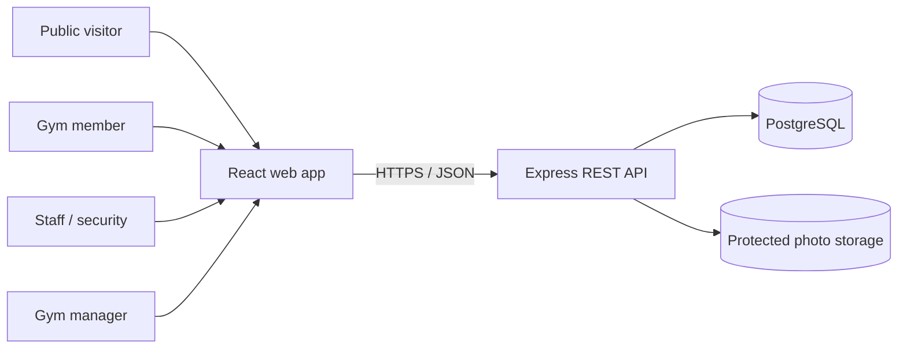
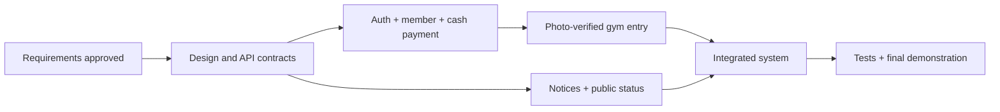

# Gym Management System (GMS) — Revised Project Plan

> **Implementation note:** The running application uses the team's selected HTML/CSS/JavaScript interface with Express and PostgreSQL. React references below describe the original proposed stack. See the [project guide](../README.md) and [implementation checklist](IMPLEMENTATION.md) for the current code and evidence. This document's pending approval status is unchanged.

**University of Eswatini · Practices in Software Engineering II (CSC491)**  
**Document version:** 3.0 — *proposed revision; pending team/client approval*  
**Prepared:** 18 October 2026  
**Delivery period:** Five development weeks, counted from the team's agreed kickoff (calendar dates to be confirmed)  
**Team size:** Four students  
**Primary client:** University of Eswatini gym management

> **Status and evidence:** This document is a planning baseline, **not** a claim that development has been completed. A revised project plan (V2), SRS (V1.0), and revised ER/UML diagrams have been prepared. Client sign-off, code implementation, testing results, and deployment have not been verified by the available documents. Business rules marked **Pending confirmation** must be agreed before the corresponding functionality is accepted.

## Document control

| Item | Detail |
| --- | --- |
| Repository location | `docs/PROJECT_PLAN.md` |
| Source baseline | Project Plan V2; SRS V1.0 (9 October 2026); revised ER/UML diagrams (proposed V3.0, 18 October 2026) |
| Requirements authority | The SRS defines the existing requirement IDs (`FR-*`, `NFR-*`, `BR1`–`BR8`). This plan identifies proposed clarifications; the SRS must be amended and approved to make them authoritative. |
| Intended audience | Project team, course lecturer, gym manager, and participating gym staff |
| Course-code check | The original plan used **CSC392**; V2 and the SRS use **CSC491**. Confirm the correct course code before submission. |
| Approval | Team: **Pending** · Gym client: **Pending** |

### Revision history

| Revision | Description |
| --- | --- |
| Original plan (unversioned) | General gym administration: members, subscriptions, payments, check-ins, reporting; four-person team and five-week development schedule. |
| Project Plan V2 | Focused on the university gym, photo-verified entry, closures, member portal, detailed requirements and business rules. |
| **V3.0 — this draft** | Aligns the plan with the SRS and proposed corrected ER/UML designs; records conflicting decisions, clarifies scope and acceptance, redistributes work to reduce Week 4 congestion, and adds a measurable progress and change-control approach. |

## 1. Introduction

### 1.1 Background and problem statement

The project addresses the University of Eswatini gym's reported reliance on paper-based member, subscription, and attendance records. The revised project materials identify two operational problems:

1. **Unverified entry:** A person may attempt to enter using another member's name or ID; a record lookup alone is not sufficient proof of identity.
2. **Uncommunicated disruptions:** Gym and service/area closures or altered opening times may not be visible to members before they travel.

Manual records also make it harder to prevent duplicate registrations, calculate subscription expiry consistently, retrieve payment histories, and report attendance. The client's current procedures and exact operating policies must be confirmed during requirements validation.

### 1.2 Proposed solution

GMS is a **responsive web application**, using a React frontend, Node.js/Express backend, and PostgreSQL database. Staff register members in person after checking a physical ID document and capturing a photo. At entry, staff search for a member, compare the visitor to the protected member photo, and explicitly confirm identity before saving the check-in. The system checks membership validity and maintains payment, entry, and denial history.

The manager maintains membership plans, publishes gym-wide or service-specific notices, changes normal and one-off operating hours, and views aggregate membership/attendance reports. Visitors can read a public gym-status page **without logging in**; registered members can log in to view their own subscription, payments, and notices.

### 1.3 Objectives and measurable outcomes

| Objective | Acceptance indicator |
| --- | --- |
| Prevent unverified check-ins | **100%** of accepted check-ins identify the confirming staff account; the system never saves one without explicit photo confirmation. |
| Centralize member identities | Registration requires accepted ID type, ID number, and protected photo; duplicate `(id_type, id_number)` pairs are rejected. |
| Calculate renewals accurately | Each confirmed cash payment is recorded separately; expiry follows the agreed date convention, including early-renewal stacking. |
| Communicate closures | A published *upcoming* closure is visible publicly **before its start date** and clearly distinguished from a currently effective closure. |
| Retain operational history | Member, payment, check-in, and denied-attempt histories can be reviewed by authorized users, including for lapsed members. |
| Give management oversight | Dashboard active/lapsed/new member totals and check-in charts agree with test data. |
| Meet usability/performance criteria | Member search and photo/status display complete in **under two seconds** under SRS-defined normal load; public page loads in **under three seconds** on the target test connection. |

The performance target concerns **system response**, not the time a staff member spends physically comparing photographs.

### 1.4 Scope and priorities

**Must-have (release acceptance):**

| Plan ID | Area | Required scope | SRS linkage |
| --- | --- | --- | --- |
| R1 | Accounts and access | Individual staff/manager logins, password hashing, role enforcement, account disable/reset, accountable actions. | `FR-AUT` |
| R2 | Manager communication | Notices and cancellations; weekly/dated gym and service hours; public status page; audit of changes. | `FR-NOT`, `FR-PUB` |
| R3 | Member registration | In-person registration with approved ID, photo, password, uniqueness rule, search/edit, account status and expiry warning. | `FR-MEM` |
| R4 | Plans and member portal | Manager-maintained plans, public plan list, member login and private plan/expiry/payment/notices view. | `FR-PLN`, `FR-POR`, `FR-AUT-08/09` |
| R5 | Payments/renewals | Cash payment recording by staff, unique receipts, early-renewal stacking, expiry preview and payment history. | `FR-PAY` |
| R6 | History and denials | Persistent member/payment/check-in history and staff-attributed declined-entry records. | `FR-HIS` |
| R7 | Gym entry | Photo-confirmed gym-level check-in, expiry check, prevention of duplicate open visits, staff check-out. | `FR-CHK` |
| R8 | Dashboard | Manager-only active/lapsed/new member counts and weekly/monthly check-in charts. | `FR-DSH` |

**Should-have (after the Must flows are stable):** automatic closing-time checkout (`FR-CHK-09`); days-left confirmation after check-in (`FR-CHK-10`); idle-session logout (`FR-AUT-10`); retiring plans with past payments (`FR-PLN-02`); extra dashboard charts (`FR-DSH-07`); and optional ID masking outside the mandatory protected areas (`FR-MEM-10`). **Note:** The previous V2 plan made automatic checkout part of R7's mandatory “Done when” text; this draft adopts the SRS *Should* priority **provisionally**, pending coordinated approval.

**Out of scope for this five-week release:** native mobile app, email/SMS delivery, online/card payment processing, biometric/RFID/card-reader access hardware, equipment booking, and fitness-class scheduling. The website remains usable on phones.

**No plan-to-service access restrictions** are included: the revised diagram model treats services as gym areas used for notices and hours, not paid access tiers. Confirm with the client before changing this assumption.

## 2. Stakeholders and user involvement

| Stakeholder | Involvement | Planned checkpoints |
| --- | --- | --- |
| Gym manager (client) | Confirms prices, subscription rules, receipt handling, opening hours, authorized photo access and reporting needs; reviews notices/dashboard. | Week 1 policy interview; Week 2 design sign-off; Week 4 demonstration; Week 5 acceptance. |
| Front-desk/security staff | Explains registration, physical ID inspection, cash receipts, photo checks, denied access, and check-out processes. | Weeks 1, 2, 4 and 5. |
| Gym members (student and non-student) | Reviews clarity of public notices and private membership page. | Selected usability review in Week 5, if available. |
| Four-person student team | Develops, documents, integrates, tests, and delivers the system. | Weekly sprint reviews and GitHub issue updates. |
| Course lecturer | Evaluates process, artifacts, functionality and demonstration. | Submission milestones and final presentation. |

**Inputs requested from the client:** accepted ID and age rules, sample *dummy* registration/payment data, plans/prices/duration rules, receipt-number policy, service/area list, actual operating hours, closure-notice expectations, and agreed privacy/retention procedures. Do not store real ID numbers or member photographs during development.

## 3. Business rules and design decisions

The rules below distinguish the existing SRS baseline from recommended corrections. **Pending items are not treated as already approved.**

| Rule | Planned behaviour | Status |
| --- | --- | --- |
| Identity uniqueness (`BR3`) | `(id_type, id_number)` is unique per member. ID type is required at member login along with ID number and password. | SRS baseline |
| Entry verification (`BR4`) | Staff select the member, verify the visitor against the photo, and explicitly confirm; search terms are never identity proof. | SRS baseline |
| Staff accountability (`BR8`) | Staff/manager have individual accounts; successful entry, payments, denials, and notice/hour edits capture the actor. | SRS baseline; audit design expanded |
| Cash-only payments (`BR7`) | Staff record cash received; each payment has member, plan, amount, date, receipt, staff, and resulting expiry. | SRS baseline |
| Payment history as expiry source | The latest **confirmed** payment determines the current plan and expiry; avoid duplicating a separately editable expiry field on `MEMBER`. | SRS §3.5 and proposed diagrams; update conflicting Plan V2 wording |
| Renewal stacking (`BR2`) | If membership is still active, add new plan days to existing expiry; otherwise start a new period using the payment date and chosen date-counting convention. | SRS baseline; day-counting **Pending confirmation** |
| Inclusive date proposal | If purchase date counts as Day 1: `new_expiry = payment_date + duration_days - 1`; if still active: `new_expiry = current_expiry + duration_days`; `days_remaining = max(0, expiry - today + 1)`. | **Pending client approval**; differs from literal `payment_date + duration_days` wording in the current SRS |
| Account vs membership status | `account_status` (enabled/suspended) is independent of computed `membership_status` (active/expired). Only enabled members with valid membership may enter. | Proposed clarification; update SRS/plan when agreed |
| Future notices | Publish immediately; show **upcoming** before start, **in effect** during the closure, hide after end/cancellation. | Proposed resolution of Plan R2 vs SRS UC-08 conflict; approval needed |
| Schedules | A schedule/override can apply to the whole gym or one service; a date-specific override takes precedence over regular weekday hours for that date. | SRS baseline / proposed diagram implementation |
| History (`BR5`) | No application-level hard deletion of member, payment, check-in, or denied-attempt records during the project pilot; access is restricted. Retention and lawful deletion policy needs client review before real deployment. | SRS baseline + deployment safeguard |
| Closing-time checkout | Manual checkout is mandatory; automatic checkout remains a **Should** feature until its priority and exact closing-time policy are agreed. | **Pending** alignment of Plan R7 and `FR-CHK-09` |
| Minors | Guardian/consent fields are not mandatory until eligibility and required information are confirmed. | **Pending client approval** |

## 4. System design and implementation

### 4.1 Technology stack

| Layer | Planned technology |
| --- | --- |
| User interface | React, responsive browser application |
| Backend | Node.js + Express, REST APIs |
| Database | PostgreSQL with foreign keys, unique constraints and transactions |
| Source control | Git + GitHub; feature branches and reviewed pull requests |
| API testing | Postman or equivalent REST tool |
| Designs | ER diagrams, UML/class/use-case/sequence diagrams, architecture diagram, UI wireframes |
| Hosting | Demonstration service to be selected and tested before Week 4 ends |

### 4.2 Logical modules and database entities

**Accounts/identity:** `STAFF_ACCOUNT` for staff and managers; `MEMBER` stores member identity, member password hash, login protection status, and secured photo reference. Member login is **not** modeled as a staff account.

**Subscriptions/payments:** `PLAN` and append-only `PAYMENT`, including amount, receipt, staff actor, confirmation and resulting expiry. Current subscription is derived from confirmed payments; no independently editable duplicate membership expiry is introduced.

**Attendance/history:** `CHECKIN` holds entry time, confirming staff member and exit time; `DENIED_ATTEMPT` stores attempt time, reason, staff member and the member reference if known. At most one check-in may remain open per member.

**Communications:** `SERVICE` for gym areas; `NOTICE` for whole-gym or service-level announcements; `OPERATING_TIME` for regular weekly hours; `TIME_OVERRIDE` for one-day exceptions; `AUDIT_EVENT` for managerial modifications. A nullable service reference denotes the whole gym.

**Reporting:** Dashboard statistics are queries/views derived from the operational tables, **not** manually maintained counters.

### 4.3 Design artifacts and key constraints

- Use the **revised** ER and UML class models as the *proposed* design baseline, then obtain approval and align the SRS text before freezing database/API definitions.
- Enforce composite unique identity (`id_type`, `id_number`), unique receipt numbers, required photo path, and foreign-key links.
- Enforce at most one open check-in per member (for example, a PostgreSQL partial unique index).
- Use database transactions for registration + first payment, and for payment confirmation + expiry recording; validate retry behaviour to avoid duplicate receipts/payment submissions.
- Enforce authorization on the server. Photos must use protected routes/files; neither the member portal nor public page exposes them.
- Audit who changed notices or operating times; allow **public reading** of notices for everyone, but **manager-only editing**.
- Resolve a future notice's **publication visibility** separately from its effective start/end dates.
- Document API contracts and error responses before frontend/backend integration.

## 5. Team organization and responsibility

The original project plan names the following team members. Confirm names, student numbers, and current role assignments before publication or grading.

| Original-plan member | Primary role | Module / process ownership |
| --- | --- | --- |
| Wakhile Mabuza | Team Manager | Delivery coordination; interviews, GitHub reviews, acceptance tests; co-implements notices, hours and public status. |
| Sean Rodrigues | System Architect | ER/UML/architecture, database, APIs, expiry policy implementation/review, portal data, dashboard queries. |
| Njabulo Simelane | UI/UX Designer | Wireframes and React UI for registration, check-in, renewal, public page, portal and dashboard; responsive testing. |
| Sakhiwo Magongo | Programmer (Backend & Integration) | API integration, server-side authentication/authorization, member and payment APIs, check-in/denial logic, deployment integration. |

**Shared ownership:** All four contribute code as feasible, review pull requests, test dependent components, and help with final documentation and demonstration. The Architect owns database migrations and key rules, while the Team Manager/Designer can implement notices independently to reduce the backend lead's workload.

**Coordination:** Use GitHub Issues and a weekly milestone board; develop each feature on a separate branch, request one peer review before merge, keep test evidence with the relevant issue, and record decisions in this plan or a decision log. Team communication: WhatsApp plus scheduled meetings.

## 6. Development methodology and five-week schedule

The project uses short, Agile-style weekly iterations. This is a **relative schedule**: actual dates must be added once the official kickoff and submission deadline are confirmed. Integration and module testing begin before Week 5.

### 6.1 Work plan

| Week | Focus and main activities | Lead / supporting roles | End-of-week exit criteria |
| --- | --- | --- | --- |
| **1 — Requirements & planning** | Interview client/staff; validate two problem statements; resolve open policies; prioritize Must/Should; align plan/SRS; create issues and repo conventions; establish dev tools. | Manager lead; Architect on requirements; all participate. | Client-reviewable requirements baseline, decision log, GitHub repository and working environments. **Approval is a gate, not assumed.** |
| **2 — Architecture & design** | Finalize ER/UML, architecture, database migrations, API contracts and security design; wireframe staff/manager/member/public views; derive tests; build minimal app and public-page skeleton. | Architect/design lead; Designer UI; Manager test cases; Programmer feasibility and API scaffolding. | Reviewed schema/design, UI wireframes, acceptance tests and integrated app skeleton. |
| **3 — Core features + early communications** | Implement staff/manager/member authentication, registration/photo storage, plans, payment/renewal, expiry calculation; implement first publish/read notice workflow and usable public status page; begin check-in API. | Programmer core APIs; Architect database/rules and dashboard groundwork; Manager + Designer notices/public page; Designer registration screens. | Demo: login, register, first cash payment, renew, and publish an **upcoming** closure that the public can see. |
| **4 — Attendance, portal, reports & integration** | Complete photo-confirmed entry/check-out, duplicate-entry blocks, denied-attempt logs, schedule overrides, member portal, manager dashboard; integrate APIs/UI; deploy rehearsal; client walkthrough. | Programmer attendance; Architect queries, portal data and defect support; Manager notices/overrides; Designer portal, check-in UI and dashboard. | Demo: end-to-end register → pay → verify → enter → exit; closure/override displayed; manager figures populated; deployed test system. |
| **5 — Verification & submission** | Unit, API, integration, security, performance and usability testing; fix defects; regression tests; accessibility/mobile checks; backup/recovery check; finalize documentation and staff guide; final demo. | Manager testing/submission lead; all fix, test and present. | Approved Must-function acceptance results, defect log and release notes; demonstration and final submission. |

**Capacity safeguard:** Implement notices/public-status in Week 3 rather than leaving all communications until Week 4. If delays occur, stop adding Should features and protect the two Must user journeys: **verified gym entry** and **public closure communication**. The full Must baseline must still be resolved with the client/lecturer if delivery cannot fit the available time; do not silently mark dropped Must features as completed.

### 6.2 Relative Gantt matrix

`●` = main effort; `◐` = preparation, integration or review; `—` = no dedicated work planned.

| Workstream | W1 | W2 | W3 | W4 | W5 |
| --- | :---: | :---: | :---: | :---: | :---: |
| Interviews, scope, and policy decisions | ● | ◐ | — | ◐ | — |
| Requirements, test cases and traceability | ● | ● | ◐ | ◐ | ● |
| Architecture, ER/UML, database, API design | ◐ | ● | ◐ | ◐ | — |
| Wireframes, frontend foundation | ◐ | ● | ● | ◐ | ◐ |
| Authentication, registration, photos | — | ◐ | ● | ◐ | ◐ |
| Plans, cash payments, renewals | — | ◐ | ● | ◐ | ◐ |
| Notices, public status, hours | ◐ | ◐ | ● | ● | ◐ |
| Check-in, check-out, denial history | — | ◐ | ◐ | ● | ◐ |
| Member portal, dashboard | — | ◐ | ◐ | ● | ◐ |
| Integration and demo deployment | — | ◐ | ◐ | ● | ● |
| Verification, fixes, documentation, handover | ◐ | ◐ | ◐ | ◐ | ● |

### 6.3 Milestones and critical path

| Milestone | Target | Evidence required |
| --- | --- | --- |
| M1 — Requirements baseline | End W1 | Meeting notes, confirmed decisions, approved requirement list, prepared repository. |
| M2 — Design baseline | End W2 | Finalized ER/UML, architecture, migration draft, UI screens, API contracts and test cases. |
| M3 — Core + notice prototype | End W3 | Working registered member, cash-payment renewal, logins and public upcoming notice. |
| M4 — Integrated feature demo | End W4 | Entry verification and denials, status updates, member portal, dashboard and hosted prototype. |
| M5 — Validated release | End W5 | Acceptance-test evidence, corrected defects, documentation, guide and live demonstration. |

Dependency notes: Gym-entry validity relies on registration and expiry rules; public status relies on schedules/notices but can be developed independently. Report queries depend on real member/payment/check-in data. Client approval of date-counting, minors and receipt rules is a decision dependency, not an optional future enhancement.

## 7. Risks and mitigations

| Risk | Likelihood / impact | Mitigation and owner |
| --- | --- | --- |
| Scope exceeds five weeks | High / High | Protect Must requirements, move Should items behind acceptance gate, review weekly. **Manager** |
| Single backend-integration bottleneck | High / High | Architect owns migrations/expiry; Manager + Designer own notices UI/API; pair review and integrate early. **Programmer + Architect** |
| Requirements not approved / client unavailable | Medium / High | Schedule Week 1 meeting, send written decisions, mark assumptions visibly and request sign-off. **Manager** |
| Expiry off-by-one / inconsistent state | Medium / High | Approve date convention, single calculation function, payment-derived expiry, boundary tests. **Architect** |
| Identity impersonation despite photo | Medium / High | Staff physical ID verification at registration and explicit photo check at entry; denied-attempt audit and training. **Manager + Programmer** |
| Unauthorized member data / photo exposure | Medium / High | Protected photos, server-side roles, hashed passwords, masked IDs, dummy test data and security tests. **Programmer** |
| Double payment / duplicate check-in | Medium / High | Transactions, unique receipt, one-open-check-in constraint, duplicate-submit tests. **Architect + Programmer** |
| Closures posted but not seen | Medium / Medium | Public page without login, prominent upcoming/effective labels, gym posters and staff reminders; no promise of push alerts. **Manager** |
| Network or demo-host downtime | Medium / High | Decide hosting early, Week 4 rehearsal, database export and local demonstration fallback. **Programmer** |
| Poor staff usability | Medium / Medium | Focused check-in UI, photo/status visibility, Week 4 staff review, Week 5 usability test. **Designer** |
| Privacy/retention policy uncertainty | Medium / High | No real member data without authorization; validate retention, consent and guardian policy before a live pilot. **Manager** |
| Team coordination and merge conflicts | Medium / Medium | Weekly board, feature branches, reviewed pull requests, API contracts and short integration cycles. **All** |

## 8. Quality standards and security

- **Code quality:** modular frontend/backend separation, shared conventions, documented API interfaces, reviewed pull requests and traceable commits.
- **Database integrity:** migrations, primary/foreign keys, unique identity and receipts, transaction-safe payments, no duplicate open visits, append-only operational logs at the application level.
- **Authentication:** hashed passwords; member lock after **five consecutive wrong passwords**; disabled staff accounts blocked; server-enforced roles and member-record ownership.
- **Privacy:** development uses dummy data; protected photo files; no photos or full ID numbers in public pages, dashboards or reports; HTTPS in deployed environments.
- **Usability:** common staff tasks can be completed after about 15 minutes of guidance; public and member screens remain usable at widths from **360 px**.
- **Availability and backup:** target availability during gym hours for a real pilot; test deployment during Week 4 and export database at least weekly and before demonstration.
- **Testability:** map each `FR-*`/`NFR-*` to expected evidence and a test result; defects receive owner, severity, fix and retest status.

## 9. Test and acceptance plan

**Testing starts with individual features** and expands to integrated workflows, access-control checks, mobile usability, and performance tests. Execute with fictitious users and sample photographs only.

| Test area | Representative case | Expected acceptance result |
| --- | --- | --- |
| Role security (`FR-AUT`) | Staff request manager dashboard or notice-edit API; disabled account logs in. | Server rejects unauthorized requests and disabled account. |
| Member login (`FR-AUT-09`) | Five incorrect passwords for one member. | Temporary member lock takes effect. |
| Registration (`FR-MEM`) | Missing photo; duplicate ID type/number; different ID types with similar number. | Missing-photo/true duplicate rejected; composite-key rule applied correctly. |
| Membership (`BR1`, `BR2`, `FR-PAY`) | New period, expired renewal, active renewal with 8 days left + 30-day plan. | New expiry follows **approved** convention; active renewal shows 38 days under the agreed days-left formula. |
| Cash audit (`FR-PAY-06`) | Payment confirmed, refresh/retry attempted. | Exactly one valid recorded payment/unique receipt; staff recorded. |
| Entry (`FR-CHK`) | Check-in without confirmation, expired account, suspended account, duplicate entry. | No unauthorized check-in; rejection is logged with staff and reason. |
| Exit (`FR-CHK-08/09`) | Manual checkout; optional auto-checkout at closing if selected. | Visit closes correctly; optional test applies only when approved and implemented. |
| Denial history (`FR-HIS`) | Unknown ID or mismatched photograph. | Reason/time/staff stored; member nullable when unknown. |
| Notices (`FR-NOT`, `FR-PUB`) | Publish tomorrow's gym closure today; edit and cancel. | Upcoming notice visible immediately without login; effective state changes on start; cancelled/expired hidden. |
| Operating times (`FR-NOT-05`) | Add one-day service closure. | That date overrides weekly schedule and normal hours resume afterward. |
| Privacy (`FR-POR`, `NFR-04/06`) | Member A guesses Member B's URL or protected photo URL. | Server refuses access; no private data leakage. |
| Dashboard (`FR-DSH`) | Compare counters and charts with seeded visits/payments. | Correct active/lapsed/new counts and weekly/monthly accepted-check-in counts. |
| Performance (`NFR-01/02`) | Measure search/photo display and public-page load under specified test conditions. | Under **2 seconds** for search/display; under **3 seconds** for public page. |
| Reliability (`NFR-09/10`) | Interrupt save and check exported backup/restore procedure. | Complete-or-no-save behaviour; recoverable backup for demo. |

### Definition of Done (per Must feature)

- [ ] Relevant SRS requirement and client decision are clear.
- [ ] Database/API/UI changes are implemented and reviewed.
- [ ] Test evidence verifies the normal and failure paths.
- [ ] Access controls, input validation, and privacy checks pass.
- [ ] Feature integrates successfully with dependent modules.
- [ ] README, diagrams, plan or SRS change notes are updated if behaviour changed.
- [ ] Owner and reviewer mark the GitHub issue complete.

## 10. Resources and dependencies

**People:** Four student team members, gym manager, front-desk/security representative, selected usability testers, lecturer.

**Hardware:** Team laptops, working internet/network, a webcam or phone camera for *dummy* photo capture, a phone/browser for responsive checks.

**Software/services:** VS Code or equivalent editor, Git/GitHub, React, Node.js, Express, PostgreSQL, test browser(s), Postman/equivalent, diagramming/wireframing tools, demo host to be selected.

**External dependencies:** Timely client policy responses; institutional requirements for real-member personal information; staff availability for demos; course submission deadline; dependable hosting or local fallback. Versions, environment variables, scripts and deployment URLs must be documented when implemented rather than invented in advance.

## 11. Deliverables, documentation and evidence of progress

### Expected repository artifacts

| Location (recommended) | Artifact |
| --- | --- |
| `README.md` | Overview, architecture, requirements status and developer setup instructions once verified. |
| `docs/PROJECT_PLAN.md` | **This** revised project plan. |
| [Original SRS](source-documents/Gym_Management_System_SRS.docx) | Existing SRS V1.0, updated/approved successor when available. |
| [Revised diagrams](source-documents/Gym_Management_System_Diagrams_Revised.docx) | Proposed reconciled ER/UML models pending approval. |
| `docs/decisions.md` | Meeting decisions and client policy approvals (to create). |
| `docs/test-plan.md` | Acceptance cases, observed outcomes and defect references (to create). |
| `frontend/`, `backend/`, `database/`, `tests/` | Suggested source/test folders **only when actually created**. |

### Evidence-based progress snapshot — 18 October 2026

The boxes below describe **verified document availability in this project context**, not the completion of all work scheduled for a given week.

- [x] General original project plan prepared.
- [x] Revised Project Plan V2 prepared.
- [x] SRS V1.0 prepared, with linked requirements and acceptance cases.
- [x] Revised ER and UML class diagrams prepared **for review**.
- [x] GitHub-ready project README prepared.
- [x] Proposed aligned plan (this V3.0 draft) prepared.
- [ ] Gym management confirms open business decisions and validates the project requirements.
- [ ] Updated SRS formally incorporates approved notice, expiry and status policies.
- [ ] Final diagrams, detailed architecture, wireframes and schema receive team review.
- [ ] Core React/Express/PostgreSQL implementation is demonstrated.
- [ ] Deployment and all mandatory acceptance tests are evidenced.
- [ ] Client/lecturer accepts final deliverables.

Progress should subsequently be tracked in GitHub Issues/Projects with **Not started / In progress / In review / Verified** statuses. Do not translate documentation existence into a percentage of implemented functionality.

## 12. Change management

1. Open a GitHub Issue describing the change, rationale, affected `R*`/`FR-*`/`NFR-*` references, new risks and proposed priority.
2. The Team Manager coordinates review with affected owners; client-facing policy/scope changes require gym/client confirmation.
3. Evaluate impacts on weekly milestones, database/migrations, API, UI, test cases, privacy and other features.
4. Update **SRS + project plan + diagrams** together for an approved rule change; record the decision/date/approver in `docs/decisions.md`.
5. Implement on a branch; include related tests and review before merge. Log any deferred work without silently removing mandatory scope.

### Changes introduced by this V3.0 draft

| Change | Reason and effect |
| --- | --- |
| Upcoming notices visible upon publication | Resolves Plan R2 vs SRS UC-08 contradiction; requires coordinated requirements update. |
| Single payment-derived expiry source | Removes Plan R3 vs SRS §3.5 duplication conflict. |
| Explicit pending inclusive-day rule | Makes 30-day subscriptions and date-boundary tests unambiguous once approved. |
| Separate account status and subscription validity | Resolves ambiguous manual active/inactive member status. |
| Automatic closing checkout treated as Should for planning | Aligns provisional priority to `FR-CHK-09`; V2 Done criterion needs amendment if confirmed. |
| Staff-account and member-credential separation | Matches the SRS's distinct login methods and proposed ER/UML model. |
| Gym-wide/service-specific notices and hours | Enables service-area scheduling without an unsupported plan–service access relationship. |
| Notice/status moved into Week 3 prototype | Reduces the high integration load originally placed in Week 4. |
| Explicit evidence and approval gates | Distinguishes planned work from documented work, and captures unresolved client decisions. |

## 13. Open decisions and approvals

| ID | Decision required | Current working assumption / options | Required by |
| --- | --- | --- | --- |
| D-01 | Can under-18 members register? Is guardian consent/contact required? | Original plan default allows registration and records guardian information; **not approved**. | Before registration schema freeze. |
| D-02 | Can members pay unlimited time in advance? | No cap in current SRS default; **not approved**. | Before renewal implementation. |
| D-03 | What are official gym/area hours, services and closure procedures? | Manager provides configuration after launch in existing documents; obtain demonstration defaults. | Week 1/2. |
| D-04 | Receipt numbers: gym-issued entry or system generation? | Unique receipt mandatory; issuance method **pending**. | Before payment form/API freeze. |
| D-05 | Who may view photos/full identity numbers? | Staff and manager only in current SRS; verify duties and privacy procedure. | Before data-security sign-off. |
| D-06 | Is automatic closing-time checkout mandatory? Which closing time applies? | SRS says **Should**; V2 plan says **Must** in its done criteria. | Before Week 2 acceptance baseline. |
| D-07 | How are subscription dates counted? | **Proposed:** payment date is Day 1; inclusive calculation. Requires approval and SRS wording revision. | Before expiry implementation/tests. |
| D-08 | Should an upcoming closure be public immediately? | **Proposed:** Yes, labelled upcoming; avoids missed advance notice. | Before notices acceptance baseline. |
| D-09 | Do all active plans allow all gym areas? | Revised diagram assumes yes; no plan–service link. | Before schema sign-off. |
| D-10 | Confirm course code, names, student numbers and final deadline. | This draft uses CSC491 and the four names from the original plan; confirm. | Before publication/submission. |

**Approval rule:** The baseline becomes final only after the team confirms ownership/scope and the gym validates operational rules. Any approved differences must be applied to the SRS and design before implementation is declared complete.

---

*Prepared for GitHub as a revision of the team's original and V2 project plans. Sources: Gym Management System Project Plan V2; Gym Management System SRS V1.0; proposed revised ER/UML diagrams V3.0; prior original project plan. No real-member data, source-code completion or client approval is implied by this document.*
